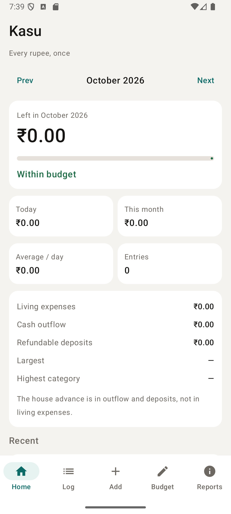

# Kasu (காசு) 💰📱

> **"Every rupee, once."**  
> A fast, privacy-first personal finance and expense tracker tailored for students and young professionals.

[](https://github.com/samuveljohnson1416/Kasu/releases/latest)
[](https://github.com/samuveljohnson1416/Kasu/releases/download/v1.0.0/Kasu-v1.0.apk)
[](android/)
[](android/)
[](src/)
[](LICENSE)

---

## 📱 App Preview

<p align="center">
  
</p>

---

## 🎯 Why Kasu?

Managing money in college or your first apartment is tough. You're balancing mess food, shared rent, fluctuating electricity bills, transport, snacks, and occasional big outflows like apartment security deposits. 

Existing budget apps are bloated, require cloud accounts, bombard you with credit card ads, and misclassify large refundable deposits as everyday "overspending."

**Kasu** (*Tamil for "money" or "coins"*) fixes this:
* **Lightning Fast:** Adding an expense takes less than **15 seconds**.
* **Zero Accounts & Offline-First:** Your financial data lives exclusively in local device storage. No logins, no tracking, no cloud telemetry.
* **Smart Categorization:** Distinguishes everyday living expenses (food, snacks, travel) from cash outflows and refundable security deposits.
* **Need vs. Want Tracking:** Tag purchases to identify impulsive spending before your month-end balance runs dry.

---

## ✨ Features

| Feature | Description |
| :--- | :--- |
| **📊 Smart Dashboard** | Real-time monthly allowance gauge, daily spending velocity, and "Within budget" status indicator. |
| **⚡ Rapid Logging** | Quick entry form with date picker, category selection, payment method (UPI/Cash/Card), and Need/Want toggle. |
| **📖 Complete Ledger** | Chronological transaction history with search, category filtering, and instant edit/delete. |
| **🎯 Budget Envelopes** | Set spending limits per category (Mess, Rent, Snacks, Travel, Utilities) and track remaining limits. |
| **📈 Visual Analytics** | Interactive breakdown charts and category distributions for monthly spending habits. |
| **💾 Export & Backup** | Export your entire ledger to **CSV** (for Excel/Google Sheets) or create full **JSON** backups. |

---

## 🏗️ Architecture & Project Structure

The project is organized as a unified monorepo with both a native Android application and a web client:

```text
Kasu/
├── android/                    # Native Android Application (Jetpack Compose)
│   ├── app/
│   │   ├── src/main/java/app/kasu/
│   │   │   ├── MainActivity.kt # Main Compose ComponentActivity
│   │   │   ├── data/           # LedgerStore (Local JSON persistence)
│   │   │   ├── logic/          # Domain models, calculations & validation
│   │   │   └── ui/             # KasuApp screens, ViewModel, and Theme
│   │   ├── kasu.keystore       # Release signing key
│   │   └── build.gradle.kts    # App build config (SDK 35, Min SDK 26)
│   ├── gradle/wrapper/         # Official Gradle 8.11.1 Wrapper
│   ├── gradlew / gradlew.bat   # Gradle CLI entrypoints
│   └── settings.gradle.kts     # Android project settings
│
├── src/                        # Web Application (React 19 + TanStack)
│   ├── components/             # Reusable UI components & spend views
│   ├── lib/                    # Zustand store and data adapters
│   ├── routes/                 # TanStack Router file-based routes
│   └── styles.css              # TailwindCSS v4 tokens and theme
│
├── screenshots/                # Verified device & simulator captures
├── scripts/                    # Automation scripts (GitHub releases, env)
├── public/                     # Static web assets & icons
├── package.json                # Web app dependencies & npm scripts
└── README.md                   # Project documentation
```

---

## 🚀 Getting Started

### 1. Android Native App (Mobile)

#### Prerequisites
* **JDK 17+** or **JDK 21**
* **Android SDK** (API 26+)

#### Build & Run via Gradle
```bash
cd android

# Build the signed release APK
./gradlew assembleRelease      # Linux / macOS
gradlew.bat assembleRelease    # Windows
```
The compiled APK will be generated at:
`android/app/build/outputs/apk/release/app-release.apk`

#### Install Directly to Connected Device / Emulator via ADB
```bash
adb install -r android/app/build/outputs/apk/release/app-release.apk
adb shell am start -n app.kasu/.MainActivity
```

---

### 2. Web Application

#### Prerequisites
* **Node.js 20+**
* **npm**

#### Development
```bash
# Install dependencies
npm install

# Start local dev server
npm run dev
```
Open [http://localhost:8080](http://localhost:8080) in your browser.

#### Production Build & Preview
```bash
# Typecheck
npm run typecheck

# Build bundle
npm run build

# Preview production build
npm run preview
```

---

## 📥 Download Release APK

The latest signed mobile APK is available directly on GitHub Releases:

* **Download Link:** [**Kasu-v1.0.apk (Direct Download)**](https://github.com/samuveljohnson1416/Kasu/releases/download/v1.0.0/Kasu-v1.0.apk)
* **Release Page:** [GitHub Releases v1.0.0](https://github.com/samuveljohnson1416/Kasu/releases/tag/v1.0.0)
* **Package Name:** `app.kasu`
* **Version:** `1.0` (versionCode `1`)
* **SHA-256 Checksum:**
  ```text
  AD3AB5CC874A2D242710DEA6563F3FB119ED7CC81BDE5D4BD2FF7068A88E69E2
  ```

---

## 📄 License

This project is licensed under the MIT License — see the [LICENSE](LICENSE) file for details.
